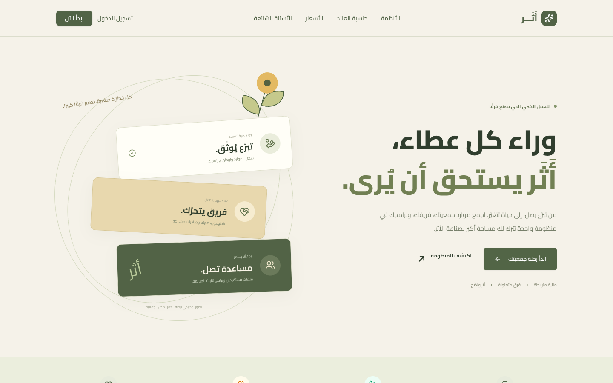
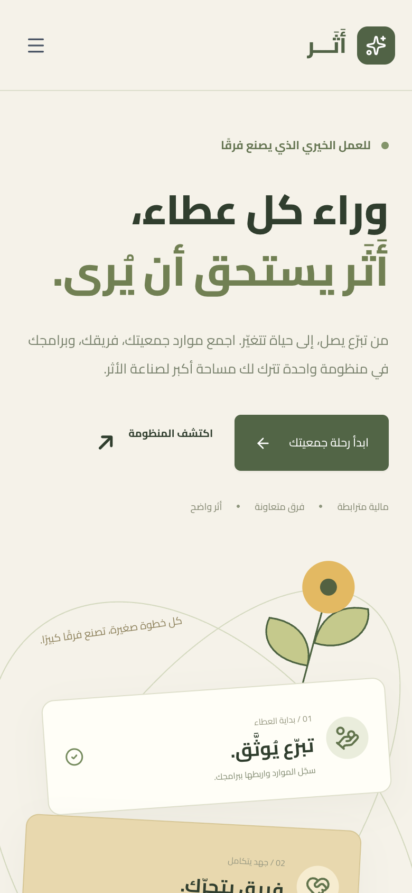
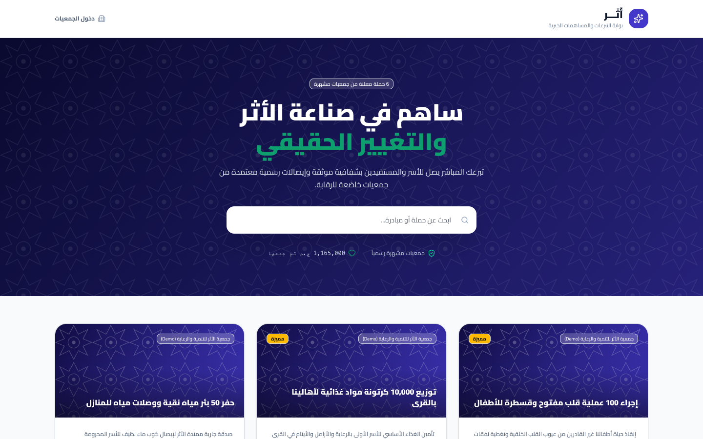
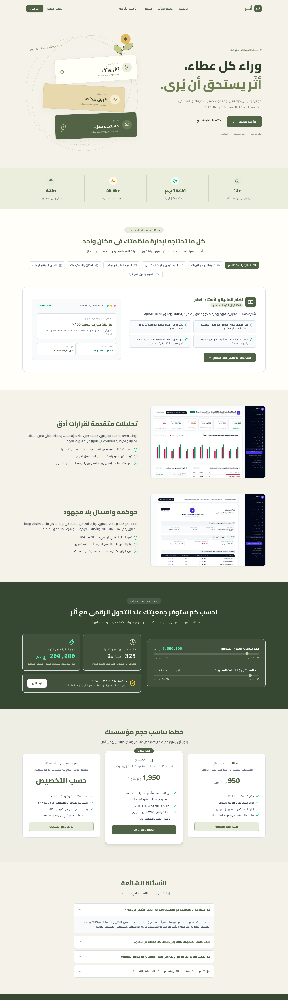

# Athar (أثر)

> Platform for charities and charitable medical centers.

**Live:** [athar.virvib.com](https://athar.virvib.com/) · **Role:** Founder & developer · **Period:** 2026 · **For:** Own product

    

## Overview

Charities manage their programs, a charitable medical complex and a smart blood-donation network from one platform.

## What it does

- Smart blood-donation network and emergency blood calls
- Public donor registration with fraud-prevention approval
- Charitable medical center: patient EHR, clinical timeline, printable prescriptions
- Modular feature toggles and Arabic roles & permissions
- Public portal per organisation

## Engineering highlights

- Real-time coordination chat over Laravel Reverb websockets
- Multi-tenant public portals

## Screenshots (live site)

  
  

Full home page

---

Source code is private (client / commercial project). This repository documents the work only.

Built by **Ahmed Gamal** — Senior Laravel Developer · [LinkedIn](https://www.linkedin.com/in/wzcoder/) · [GitHub](https://github.com/ahmed-gamal-dev)
